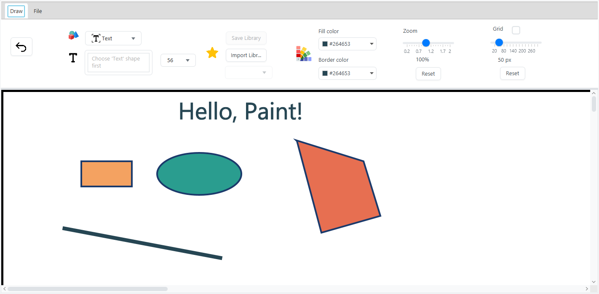
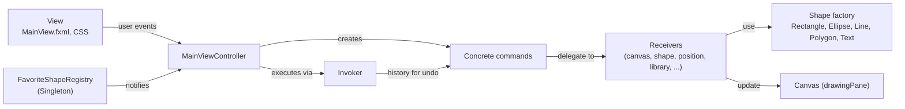

# Paint — a vector drawing tool in JavaFX

[](https://github.com/SalvatoreFTartaglione/Paint/actions/workflows/build.yml)

A desktop drawing application, similar to a minimal Paint/Inkscape, written in **Java 17 and JavaFX**.
It was developed by a team of four for the *Software Architecture Design* course (MSc in Computer Engineering,
University of Salerno, A.Y. 2024-2025) following the **Scrum** methodology: the goal was less the tool itself than
designing it with sound architecture and design patterns, and delivering it incrementally in three sprints.



## Features

| Area | What you can do |
|---|---|
| **Shapes** | Line segments, rectangles, ellipses, arbitrary polygons and text (with selectable font size) |
| **Colors** | Border and fill color pickers, with live change of existing shapes from the context menu |
| **Editing** | Select, drag, delete, cut / copy / paste, bring to front / send to back |
| **Transformations** | Resize, stretch (width/height), rotate by any angle, mirror horizontally / vertically |
| **Undo** | Unlimited undo of every operation that changes the drawing |
| **Canvas** | Zoom (20%–200%), scrolling on a canvas larger than the window, optional grid with adjustable size |
| **Files** | Save/load drawings as `.txt` (reloadable) and export them as `.png` |
| **Favorites** | Save any shape as a named, reusable "shape creation command"; export/import them as a shape library file |

## Architecture

The application follows **MVC**, and the model is organized around well-known design patterns:

| Pattern | Where | Why |
|---|---|---|
| **Command** | `model/concreteCommands`, `Invoker` | Every user action is an object that can be executed and undone, which gives unlimited undo for free |
| **Factory Method** | `model/factory` (`AbstractShape` and one creator per shape) | Shapes are created without the caller knowing the concrete class |
| **Singleton** | `FavoriteShapeRegistry` | One shared registry of favorite shapes for canvas, menus and import/export |
| **Observer** | `FavoriteObserver` | The favorites combo box updates itself when the registry changes |



```
src/main/java/org/example
├── Main.java                    application entry point
├── view/                        loads the FXML layout
├── controller/                  MainViewController, file dialogs, shape options
└── model/
    ├── commandInterface/        Command pattern: command contract
    ├── concreteCommands/        one class per undoable (or file) operation
    ├── invoker/                 executes commands and keeps the undo history
    ├── receivers/               the code that actually does the work
    ├── factory/                 Factory Method: creators and concrete shapes
    ├── registry/ + observer/    Singleton + Observer for favorite shapes
    ├── contextMenu/             right-click menu
    ├── DTO/                     state shared between controller and receivers
    └── utils/                   zoomable scroll pane, file-format escaping
```

## Getting started

Requirements: **JDK 17+** and **Maven 3.9+**.

```powershell
git clone https://github.com/SalvatoreFTartaglione/Paint.git
cd Paint
mvn javafx:run
```

Run the test suite (JUnit 5, 300+ tests, no display needed):

```powershell
mvn test
```

## File formats

Both formats are plain text, one record per line, fields separated by `;`. User-provided strings (text shapes,
favorite names) are escaped, and a file is parsed completely before the canvas is touched, so loading a corrupted
file reports the faulty line and never leaves a half-loaded drawing.

```
My custom canvas
Rectangle;0x1b3a6bff;0xf4a261ff;4.0;120.0;60.0;190.0;170.0;0.0
Text;Hello\; world;0x264653ff;0x264653ff;420.0;70.0;56.0;1.0;1.0;0.0
```

## Testing

The unit tests cover every command (execute and undo), the receivers, the shape classes, the registry and the
load/save code (round trips, corrupted files, special characters). The graphical layer itself was tested manually
following the acceptance criteria defined for each user story.

## How the project was run (Scrum)

| Sprint | Planned | Completed | Highlights |
|---|---|---|---|
| 1 | 39 SP | 39 SP | Empty canvas, basic shapes, colors, save/load, select/move/delete, undo, color changes |
| 2 | 40 SP | 42 SP | Cut/copy/paste, z-order, zoom, scrolling, grid, text shapes, refactoring |
| 3 | 44 SP (49 with a story added during the sprint) | 41 SP | Polygons, resize, stretch, rotate, mirror, favorites and shape libraries |

Roles: Product Owner — Antonio Senatore; Scrum Master — Salvatore Francesco Tartaglione; development team —
Christian Rosa and Domenico Vicidomini. All members took part in implementation and testing.

## Known limitations

- Grouping/ungrouping several shapes (the *Composite* pattern, user stories 30–31) was planned but not completed.
- The favorite shape commands are saved in separate library files, not inside the drawing file.
- Only undo is implemented (there is no redo), as required by the specification.
- The model still depends on JavaFX types and on `ShapeOption` from the controller package; a dedicated shape-type
  enum would decouple them.

## Authors

This project was developed by the Software Architecture Design Group 15:

- **Salvatore Francesco Tartaglione**
- **Christian Rosa**
- **Antonio Senatore**
- **Domenico Vicidomini**

The full development history of the team project (all commits and their authors) is preserved in this repository's
Git log. Some files that were committed during development (IDE settings, the course report PDF and very large
class-diagram exports) were removed from it.

## License

Released under the [MIT License](LICENSE).
